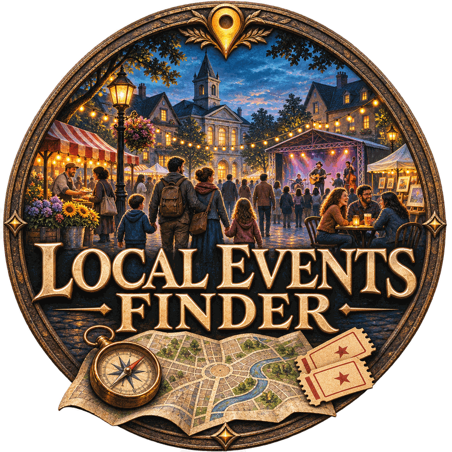

# Local Events Finder

Find things to do near you. Pick a place (or use your location), choose how far you're willing
to go, and browse what's on: scheduled events and places you can visit any day. Every result is
tagged with a colour-coded **type** (music, park, theatre, …) and, when it's meant for children,
as **kid friendly**.

[](https://therealdeltrex.github.io/Local-Event-Finder/)

**Just want to use it? Go to the [website](https://therealdeltrex.github.io/Local-Event-Finder/)**
to use it in your browser or download the Android app, no code needed. You can also take the APK
from the [latest release](../../releases/latest) directly.

All three versions share one version number, shown on the website and in each app's footer.
Licensed GPL-3.0; what changed in each release is in the [changelog](CHANGELOG.md).

## What it does

- **Find events** from the structured event data that event sites publish, for your town and
  the towns around it.
- **Find places** you can visit any day, like museums, parks, pools and viewpoints, from
  OpenStreetMap, with opening hours where known.
- **Stay in range**: everything is measured from you, with distance and compass direction, and
  dropped if it's too far.
- **Tag by type**: every result gets a colour-coded type (or "unknown") you can filter by.
- **Mark kid friendly** only what is aimed at children, with a manual on/off switch that is
  remembered for next time.
- **Filter** by type, distance and date, or show only events or only permanent places.

No accounts and no API keys. Your searches and tags stay on your device.

## Getting it

| Version | Best for | How to get it |
| --- | --- | --- |
| **Android app** | Everyday use on your phone | Download the APK from the [website](https://therealdeltrex.github.io/Local-Event-Finder/) or the [latest release](../../releases/latest) |
| **Local web app** | The most complete results on a computer | Run it yourself (see below) |
| **Browser version** | A quick try with nothing to install | Open the [website](https://therealdeltrex.github.io/Local-Event-Finder/) |

All three do the same search. The browser version has one built-in limitation: browsers can't
read some event sites directly, so it may find fewer scheduled events than the other two.

## How it works

1. **Where you are.** Your device location or a typed town is turned into
   coordinates using OpenStreetMap.
2. **What's on.** The app reads the structured event data that event sites
   publish for search engines (schema.org `Event`), for your town and the towns
   around it. Because it reads a standard format rather than one site's layout,
   new sources can be added without changing the pipeline.
3. **What's always there.** It adds places like museums, parks, pools and
   viewpoints from OpenStreetMap, with opening hours where known.
4. **What's close enough.** Everything is located, measured from you (distance
   and compass direction), and dropped if it's out of range.
5. **What it is.** Each result gets a type from its category or description
   ("unknown" when it can't tell), and a kid-friendly tag only when it is aimed
   at children. You can switch the kid-friendly tag on or off by hand, and
   your choice is kept the next time you search.

## Run the local web app

You need Python 3.10 or newer.

```bash
git clone https://github.com/TheRealDeltrex/Local-Event-Finder
cd Local-Event-Finder
python3 -m venv .venv && source .venv/bin/activate   # optional
pip install -r requirements.txt
python app.py
```

It opens in your browser at <http://127.0.0.1:5001>.

| Setting | Default | What it does |
| --- | --- | --- |
| `PORT` | `5001` | Port to serve on |
| `EVENTFINDER_DATA` | `~/Documents/LocalEventsFinder` | Folder for the cache, your tags and settings |
| `EVENTFINDER_OPEN` | `1` | Set to `0` to not open a browser on start |
| `FLASK_DEBUG` | *(unset)* | Set to turn on Flask debug mode |

To build the Android app yourself, see [android/README.md](android/README.md).

## Repository layout

| Folder | Contents |
| --- | --- |
| `eventfinder/`, `app.py`, `templates/`, `static/` | Local web app (Python + Flask) |
| `android/` | Android app (Kotlin + Jetpack Compose) |
| `docs/` | Website, browser version and the logo (served by GitHub Pages) |
| `scripts/` | Version and consistency tools |

## Versions and releases

There is one version number for the whole project, in the [`VERSION`](VERSION)
file, and every version shows it in its footer.

To make a release:

1. Add the changes under a new heading in `CHANGELOG.md`.
2. Run `python scripts/version.py set X.Y.Z` to set the new version everywhere.
3. Push a tag named after the version (for example `v1.2.0`). GitHub then
   builds and signs the APK and publishes it as a
   [release](https://github.com/TheRealDeltrex/Local-Event-Finder/releases).
   The website's download button always points at the latest release.

## Keeping the three versions in step

Each version has its own copy of the search logic, so a change to one has to be
made in all three. `python scripts/check_parity.py` compares them (keywords,
place types, sources and search features) and fails if they've drifted, and
`python scripts/version.py check` confirms the version is set everywhere. Both
run automatically on every pull request.

## Good to know

- Results depend on what event sites publish. If a site changes, it may return
  fewer events until the source is updated.
- Distances are straight-line, not travel distance.
- OpenStreetMap's public services are shared and rate-limited, so a search can
  take a minute or two. Lookups are cached to keep later searches faster.

## License

Released under the **GNU General Public License v3.0**. See [LICENSE](LICENSE).
